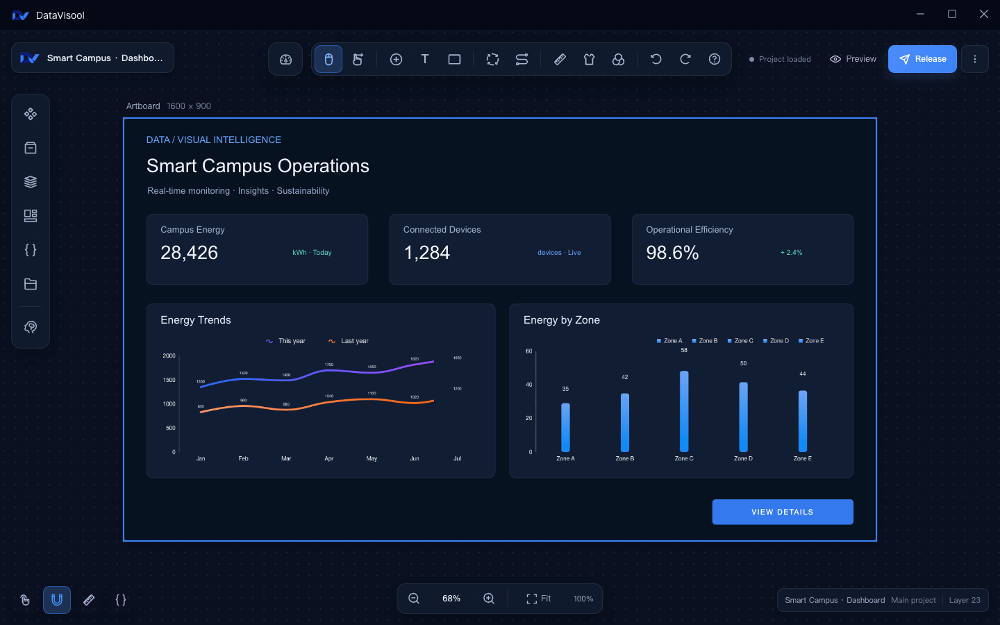

<div align="center">
  

  <h1>DataVisool</h1>

  <p><strong>Bring data, visuals, and interactions together.</strong></p>
  <p>A desktop designer for dashboards and data visualizations.</p>
  <p>macOS · Windows &nbsp; | &nbsp; React · Tauri · Rust</p>
  <p><a href="README_CN.md">简体中文</a> &nbsp; | &nbsp; English</p>

  <p>
    <a href="#features">Features</a> &nbsp;·&nbsp;
    <a href="#getting-started">Getting Started</a> &nbsp;·&nbsp;
    <a href="#run-from-source">Run from Source</a> &nbsp;·&nbsp;
    <a href="docs/en/migration.md">Migrate from LCP</a> &nbsp;·&nbsp;
    <a href="#documentation">Documentation</a> &nbsp;·&nbsp;
    <a href="#license">License</a>
  </p>
</div>

---

DataVisool brings canvas editing, data configuration, and visual interaction design into one desktop application. Combine charts and custom components to create visualizations for your project.

## Product Demo



<p align="center"><sub>From the canvas to the blueprint editor: components and interactions shown with sample data.</sub></p>

## Features

| | |
| --- | --- |
| **Visual canvas**<br>Add charts, text, images, video, maps, and other components. Adjust their layout and appearance. | **Data connections**<br>Configure static data, APIs, shared data sources, databases, and WebSocket sources. |
| **Blueprint interactions**<br>Connect component events, conditions, and actions to build interactive behavior. | **AI assistance**<br>Configure a model and use AI-driven features in the designer. |
| **Custom components**<br>Develop components with the SDK and CLI, then build and import them into the remote component library. | **Project management**<br>Preview and publish your work, or import and export projects and associated assets as project packages. |

DataVisool can import supported LCP project export packages and convert recognized legacy configurations and server component interfaces during import. Components using unsupported interfaces require additional work. See the [LCP migration guide](docs/en/migration.md) for the scope and limitations.

## Getting Started

### Installation

The desktop application targets **macOS (Intel / Apple Silicon)** and **Windows x64**. This repository does not currently provide an installer download link; you can run or build the application from source using the steps below.

### Create Your First Project

1. Open DataVisool and create a project from the project list.
2. Add charts or other components from the component library, then arrange and style them on the canvas.
3. Configure static data or connect a data source in the component settings.
4. Open the blueprint editor if needed, and connect component events to actions.
5. Preview your work or export a project package from the project menu.

## Run from Source

Install Node.js, pnpm, the Rust toolchain, and the desktop development dependencies for your platform. See the [Tauri prerequisites](https://v2.tauri.app/start/prerequisites/) for system requirements.

From the repository root:

```bash
# Install workspace dependencies
pnpm install

# Start the desktop development environment
pnpm -F datavisool-app tauri:dev
```

Startup verifies the ripgrep sidecar. If a file is missing or fails verification, run `pnpm -F datavisool-app sidecar:prepare` first. This command downloads and verifies the configured binaries for each platform.

To start only the frontend development server:

```bash
pnpm -F datavisool-app dev
```

For build, test, and release commands, see [Desktop Development and Builds](docs/en/build.md).

## Develop Custom Components

The `@datavisool/sdk` provides component contracts, while `datavisool-cli` provides tools to create, preview, and build components. To view the CLI commands from this repository:

```bash
pnpm -F datavisool-cli cli --help
```

A built component ZIP can be uploaded through the application's remote component management page. See the [SDK documentation](datavisool-sdk/README.md) for its entry points and types (in Chinese).

## Project Structure

| Directory | Contents |
| --- | --- |
| [`datavisool-app`](datavisool-app/) | Desktop application, designer, and Tauri backend |
| [`datavisool-ui`](datavisool-ui/) | React UI component library |
| [`datavisool-sdk`](datavisool-sdk/) | Component contracts, types, and shared utilities |
| [`datavisool-cli`](datavisool-cli/) | Custom component development CLI |
| [`@datavisool/interaction-engine`](datavisool-interaction-engine/) | Canvas interactions, including dragging, resizing, selection, and snapping |
| [`crates`](crates/) | Rust libraries for databases, data sources, archives, project formats, and more |

## Documentation

- [Desktop Development and Builds](docs/en/build.md) — local development, testing, and releases
- [Migrating Projects from LCP](docs/en/migration.md) — supported imports, limitations, and migration checks
- [Documentation Index](docs/README.md) — repository structure and engineering notes (in Chinese)
- [SDK Documentation](datavisool-sdk/README.md) — component contracts and public entry points (in Chinese)
- [UI Component Library Documentation](datavisool-ui/README.md) — UI components and usage (in Chinese)

## Feedback and Contributions

Use the repository hosting platform's issue tracker to report problems, suggest improvements, or share how you use DataVisool. Before submitting changes, read the project license and run the checks relevant to your changes.

## License

This project uses the [DataVisool License](LICENSE). Personal use, teaching and research, nonprofit activities, and an organization's own internal business use are permitted free of charge. Providing or distributing the software to third parties, client projects, and other specified commercial uses require prior written authorization. Organizations must retain the DataVisool branding during internal use.

**The current license is not an open-source license as defined by the OSI.** Please read the full license and applicable third-party licenses before using, modifying, or sharing the software.
