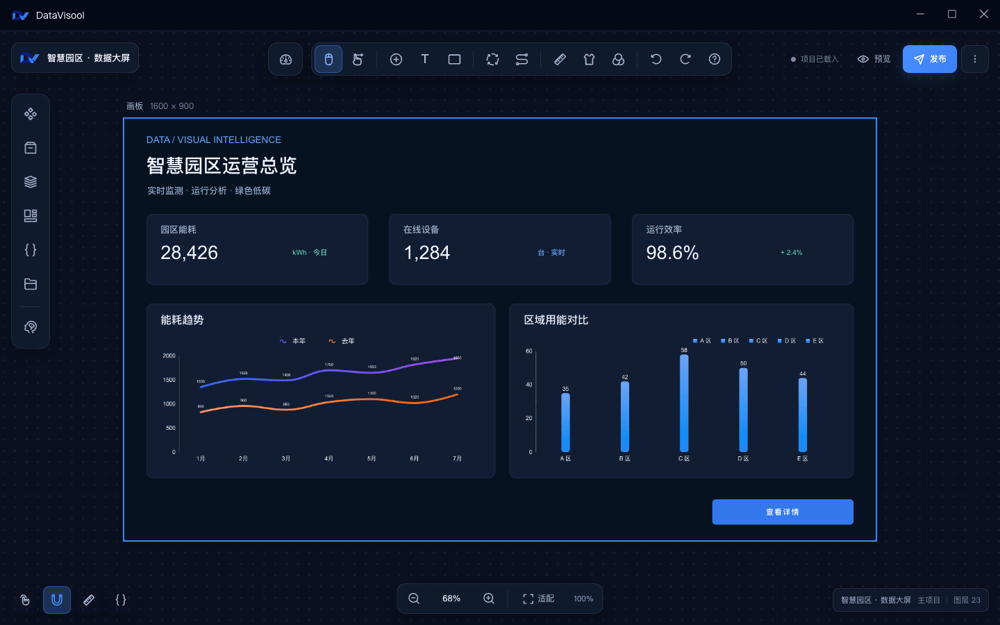

<div align="center">
  

  <h1>DataVisool</h1>

  <p><strong>把数据、画面与交互，组合成你的可视化作品。</strong></p>
  <p>一个面向大屏与数据可视化场景的桌面设计器。</p>
  <p>macOS · Windows &nbsp; | &nbsp; React · Tauri · Rust</p>
  <p>简体中文 &nbsp; | &nbsp; <a href="README.md">English</a></p>

  <p>
    <a href="#功能概览">功能概览</a> &nbsp;·&nbsp;
    <a href="#开始使用">开始使用</a> &nbsp;·&nbsp;
    <a href="#从源码运行">从源码运行</a> &nbsp;·&nbsp;
    <a href="docs/cn/migration.md">从 LCP 迁移</a> &nbsp;·&nbsp;
    <a href="#文档">文档</a> &nbsp;·&nbsp;
    <a href="#许可证">许可证</a>
  </p>
</div>

---

DataVisool 提供画布编辑、数据配置和蓝图交互，让你在一个桌面应用中组织可视化项目。从基础图表到自定义组件，你可以按项目需要组合画面与交互。

## 产品画面



<p align="center"><sub>从可视化画布到蓝图编辑器：使用示例数据展示组件与交互编排。</sub></p>

## 功能概览

| | |
| --- | --- |
| **可视化画布**<br>添加图表、文本、图片、视频、地图等组件，调整布局和样式。 | **数据接入**<br>配置静态数据、API、公共数据源、数据库和 WebSocket 等数据来源。 |
| **蓝图交互**<br>连接组件事件、条件判断和动作，编排页面交互。 | **AI 辅助**<br>配置模型，在设计器中使用 AI 驱动能力辅助项目设计。 |
| **扩展组件**<br>使用 SDK 和 CLI 开发组件，构建后导入服务器组件库。 | **项目管理**<br>预览和发布作品，使用项目包导入或导出项目与相关资源。 |

DataVisool 可以导入受支持的 LCP 项目导出包，并在导入时转换已识别的旧配置和服务器组件接口；使用未支持接口的组件需要单独处理。具体范围见 [LCP 项目迁移指南](docs/cn/migration.md)。

## 开始使用

### 安装

桌面应用面向 **macOS（Intel / Apple Silicon）** 和 **Windows x64**。当前仓库尚未提供安装包下载链接；你可以按照下方步骤从源码运行或构建应用。

### 创建第一个项目

1. 打开 DataVisool，在项目列表中创建并进入项目。
2. 从组件库添加图表或其他组件，在画布上调整布局与样式。
3. 在组件配置中设置静态数据或连接数据源。
4. 按需打开蓝图，连接组件事件与动作。
5. 预览作品，或使用项目菜单导出项目包。

## 从源码运行

准备 Node.js、pnpm、Rust 工具链和平台所需的桌面开发环境。系统依赖可参考 [Tauri 环境准备](https://v2.tauri.app/start/prerequisites/)。

在仓库根目录执行：

```bash
# 安装 workspace 依赖
pnpm install

# 启动桌面开发环境
pnpm -F datavisool-app tauri:dev
```

启动时会校验 ripgrep Sidecar。若提示文件缺失或校验失败，可先运行 `pnpm -F datavisool-app sidecar:prepare`；该命令会下载并校验项目配置的各平台二进制文件。

只启动前端开发服务器：

```bash
pnpm -F datavisool-app dev
```

完整的构建、测试和发版步骤见 [桌面端开发与构建](docs/cn/build.md)。

## 开发自定义组件

组件开发使用 `@datavisool/sdk` 提供的组件契约，以及 `datavisool-cli` 提供的创建、预览和构建工具。查看仓库内 CLI 命令：

```bash
pnpm -F datavisool-cli cli --help
```

构建后的组件 ZIP 可上传到应用的服务器组件管理页面。SDK 入口和类型说明见 [SDK 文档](datavisool-sdk/README.md)。

## 项目结构

| 目录 | 内容 |
| --- | --- |
| [`datavisool-app`](datavisool-app/) | 桌面应用、设计器和 Tauri 后端 |
| [`datavisool-ui`](datavisool-ui/) | React UI 组件库 |
| [`datavisool-sdk`](datavisool-sdk/) | 组件契约、类型与公共工具 |
| [`datavisool-cli`](datavisool-cli/) | 自定义组件开发脚手架 |
| [`@datavisool/interaction-engine`](datavisool-interaction-engine/) | 画布拖拽、缩放、选区和吸附等交互能力 |
| [`crates`](crates/) | 数据库、数据源、归档及项目格式等 Rust 基础库 |

## 文档

- [桌面端开发与构建](docs/cn/build.md) — 本地开发、测试和发版命令
- [从 LCP 迁移项目](docs/cn/migration.md) — 导入范围、限制和迁移检查
- [文档总览](docs/README.md) — 仓库结构与工程说明
- [SDK 文档](datavisool-sdk/README.md) — 组件契约与公共入口
- [UI 组件库文档](datavisool-ui/README.md) — UI 组件和使用方式

## 反馈与参与

欢迎通过项目托管平台的议题功能反馈问题、提出建议或分享使用场景。提交修改前，请先阅读项目许可证，并根据改动范围运行相应检查。

## 许可证

本项目使用 [DataVisool License](LICENSE)。个人使用、教育机构教学与研究、非营利活动及组织内部业务使用免费。向第三方提供或分发软件、为客户制作项目等指定商业用途需事先取得书面授权；组织内部使用须保留 DataVisool 品牌标识。

**当前许可证不属于 OSI 定义的开源许可证。** 使用、修改或分享前，请阅读完整许可证及相关第三方许可。
